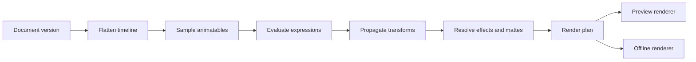

# Motioner system blueprint

## Overview

This document is the single narrative reference for Motioner's
structure: what the product is, how a project is represented in memory
and on disk, how frames are evaluated and rendered, how the code and AI
layers fit, and which trade-offs were accepted. Atomic decisions live
in `decisions/D-*.md`; the product scope lives in REF-0003.

Status: draft, aligned with the confirmed 1.0 scope (REF-0003) and the
accepted ADRs.

## 1. Product model

Motioner is a desktop motion-graphics editor and NLE with four authoring
surfaces over one shared program and its compiled document:

- A timeline and viewport in the style of After Effects.
- A Python-like executable MDF program that builds the composition.
- A node graph as an alternate compositing view.
- A chat agent that edits the program or the document through typed
  tools.

A deterministic offline renderer exports video.

The defining constraint is that the preview and the final export are the
same evaluation of the same document at the same frame, with different
quality settings. Anything that makes preview and export diverge is a
bug in the architecture, not a quality option.

2D and 3D are not separate applications. A composition is an ordered
list of layers; a layer may be a 2D element or a 3D scene, and both use
the same timeline, transforms, effects and compositor.

Out of scope for 1.0: importing AE projects, direct YouTube upload,
4K/HDR, color grading, advanced audio mastering, rigid-body physics,
cloth and fluids, macOS/Linux, plugin API, collaboration and cloud
rendering.

## 2. Architectural principles

- Determinism first. Time is integer frames plus a rational fps. Evaluation
  is a pure function of document revision, frame and settings.
- One mutation path. UI, AI and code all emit typed commands; nothing
  writes the document directly.
- Program-first. The MDF program is the editable truth; executing it
  produces a document with provenance, and overrides/bakes capture UI
  edits.
- Document and runtime are different things. The document is a compiled
  artifact; the runtime is a further compiled render plan.
- The engine is replaceable at the boundary. FerrousEngine types do not
  leak into the document, evaluator or UI state.
- Frame budget is a feature. Allocation, decoding and rendering have
  explicit budgets from the first phase.
- Text-first project files. Human-readable, diffable, migratable.
- Lazy documentation. PCS rules apply: document the domain being worked,
  not the whole system in advance.

## 3. Workspace and crates

Proposed Cargo workspace. Start with the crates Phase 1 needs and split
only when a boundary is proven.

| Crate | Responsibility | Must not depend on |
|---|---|---|
| `motioner_core` | Document model, persistent IDs, schema, commands, undo | GPU, FerrousEngine, UI, AI |
| `motioner_eval` | Time, curves, expressions, flattening into render plan | GPU, UI, AI |
| `motioner_render` | Engine adapter, render graph, compositor, effects, color | UI, AI, document editing |
| `motioner_ui` | Editor shell, panels, viewport widget, timeline widget | Engine and GUIMaker internals beyond the adapters |
| `motioner_io` | MDF format, asset store, import, ffmpeg export | UI |
| `motioner_dsl` | Grammar, parser, printer, validator, sandbox runtime | GPU, UI |
| `motioner_ai` | Provider abstractions, tools, context builder | GPU, UI internals |
| `motioner_app` | Binary, wiring, config, startup, crash recovery | Nothing above it |
| `motioner_testkit` | Fixtures, golden frames, benchmarks, mock provider | Production code paths it is testing |

Dependency direction: `app` -> `ui`, `ai`, `io`, `dsl` -> `render` ->
`eval` -> `core`. `core` is the root and has no graphics dependency.

Engine integration: a pinned FerrousEngine checkout lives outside or
inside the repository (D-0001), and `motioner_render` wraps it. The
adapter converts Motioner IDs and data into engine entities and back.
When the engine must change, prefer a small upstreamable patch recorded
as an ADR.

UI integration: the editor chrome uses the engine-native Ferrous UI plus
GUIMaker (D-0004). GUIMaker is a separate project, pinned like the
engine; `motioner_ui` is the only crate that depends on it.

## 4. Document model

Entities:

- Project: metadata, settings, asset registry, style library and
  compositions.
- Composition: name, size, rational fps, duration in frames, background,
  layer list, render settings.
- Node: stable ID, parent, children, kind, transform, opacity, blend mode,
  in/out, effects, masks and content.
- Content variants: group, solid, shape path, text, image, video, mesh,
  3D camera, 3D light, precomposition reference, adjustment layer.
- Animatable value: constant or a keyframe list. Keyframes store frame,
  value, interpolation and bezier handles.
- Effect: type, enabled flag and animatable parameters.
- Asset: content hash, kind, metadata and provenance, never mutable in
  place.
- Timeline: per-node in/out, time stretch, offset, time remap, plus
  markers.

Semantics that must be fixed and tested:

- IDs are persistent and independent of memory addresses; names are
  labels only.
- Layer order is explicit, not inferred from insertion or hierarchy.
- Time is composition-local when evaluating, with one documented
  conversion to global frames.
- Parenting affects transforms only; it never reorders layers.
- Selection, open panels, zoom and playhead position are UI state and
  are stored separately from the document.

## 5. Memory and ownership

The compiled document is designed for editing through overrides; the
runtime is designed for throughput. They use different representations.

Document side:

- Nodes and assets live in generational arenas; handles are small and
  checked, persistent IDs survive moves and reloads.
- Cold metadata and hot numeric channels are stored separately: structs
  of arrays for transforms, visibility and opacity; arrays of structs for
  rarely touched metadata.
- Names, paths and effect types are interned.
- Undo is a command log with inverses plus periodic lightweight
  snapshots. Reference-counted document versions give autosave and
  background jobs a consistent read-only view.

Runtime side:

- Evaluation writes into reusable scratch arenas cleared per frame; no
  per-frame heap allocation on the hot path.
- Render items are a flat, cache-friendly array with resolved transforms,
  colors, effect parameters and asset handles.
- Curve samples and frame results are cached by revision hash, never by
  wall-clock time.
- The render adapter owns GPU resources and pools textures and buffers by
  format and resolution; eviction respects an explicit VRAM budget.
- Asset decode and import run on worker threads; the hot path consumes
  ready handles only.

Budget policy: the editor targets interactive UI frame times, the
viewport targets a documented preview fps at proxy resolution, and the
renderer refuses to allocate beyond its VRAM budget instead of failing
silently.

## 6. Evaluation pipeline

Input: a document version, a frame number, the frame rate, render
settings and an asset snapshot.

Steps:

1. Resolve the active composition and its time base.
2. Flatten the layer list, resolving in/out, stretch, offset and
   precomp nesting.
3. Sample every animatable property at the frame, using cached curves.
4. Evaluate sandboxed expressions and generators with deterministic
   inputs and limits.
5. Propagate transforms through parenting and resolve visibility.
6. Resolve effects, masks and track mattes in layer order.
7. Emit a render plan: ordered render items, pass hints and resource
   requirements.

Properties of the pipeline:

- Pure: no wall clock, no ambient RNG, no I/O; randomness is seeded from
  stable inputs.
- Incremental: dirty flags and revision hashes avoid re-evaluating
  untouched subtrees, but correctness wins over reuse.
- Identical for preview and export: only resolution, sample counts and
  quality settings differ.

## 7. Rendering

FerrousEngine is the GPU host: one wgpu device shared by the viewport
and the editor UI. The render plan is consumed by a render graph of
passes over pooled RGBA16F targets.

Core passes:

- 2D layer pass: shapes, paths, text, images and solids with premultiplied
  alpha.
- 3D scene pass: PBR materials, cameras, lights, depth and alpha output.
- Per-layer effect chain: blur, glow, color correction, grain and other
  effects declared by the render plan.
- Mask/matte pass: mask buffers and track matte resolution.
- Composite pass: explicit layer ordering, blend modes and adjustment
  layers.
- Post pass: bloom, tonemapping, display transform, optional LUT.

Color policy: linear workspace, premultiplied alpha everywhere, HDR
intermediates, explicit display transform, color-tagged output.

Determinism policy: fixed sample patterns, stable sorting, no
time-dependent jitter, documented tolerance for GPU floating-point
differences, golden-frame tests for every blend mode and effect.

Preview policy: proxy resolution and quality presets, frame skipping
under load, cached frames for scrubbing. Final render always runs at
output resolution with final sample counts.

Export policy: offscreen render at output settings, frames piped to
ffmpeg to avoid temporary image sequences, optional PNG sequence for
debugging, progress and cancellation through the render queue.

## 8. Project format and assets

Canonical format: the Motioner Document Format (MDF), a program-first,
Python-like language shared with the code layer (D-0011). There is no
RON, JSON or database canonical format.

Project folder: `<name>.motioner/`.

- `project.motion` - entry program and manifest with format version,
  settings, asset registry and composition references.
- `compositions/<slug>.motion` - one program per composition.
- `overrides.motion` - UI overrides applied after program execution.
- `assets/<hash>.<ext>` - immutable content-addressed blobs, with
  provenance and metadata in the manifest.
- `cache/` - decoded assets and frame caches, safe to delete.
- `backups/` - autosave and recovery snapshots.
- Optional packed single-file archive of the same structure for sharing.

Format rules:

- Every file declares a format version; loading an old project runs
  explicit migrations.
- Serialization order is deterministic so version control diffs are
  meaningful.
- Unknown fields are rejected with a clear error, never silently
  dropped.
- Assets are immutable; editing one produces a new hash.
- The on-disk files are MDF programs, the same text shown in the code
  panel and executed by the runtime.

## 9. Code layer and AI

The code layer is program-first: the MDF program is the truth. It is a
Python-like executable language with variables, functions, conditionals
and loops. Executing it produces a document snapshot with provenance
links from elements back to source spans. UI edits become structured
overrides keyed by stable identity, or bake an element, and are written
back to MDF; orphaned overrides are reported.

The language covers compositions, layers, properties, keyframes,
effects, assets, precomps and LaTeX math. Execution is deterministic and
sandboxed: no filesystem, network, process or ambient time, with fuel and
time limits. The on-disk project, the code panel and the AI all use the
same language and runtime.

The AI is a client of the same command surface as the UI:

- Tools map one-to-one to document commands and return typed results.
- The context builder sends a compact outline and selected layers, then
  retrieves details on demand, in the spirit of PCS context budgeting.
- Every AI change is a reviewable transaction with a diff and a
  human-facing summary; destructive or expensive actions require
  confirmation.
- The agent cannot run shell commands or touch arbitrary files.

This gives three equivalent ways to author the same project: UI edits,
code edits and chat instructions, all recorded as commands.

## 10. Editor UI

Target layout: project/assets browser, composition viewport, timeline
with layers and keyframe graph, inspector and effects, render queue,
code editor and chat panel. Layout is dockable, persistent and
restorable.

Toolkit decision (D-0004): engine-native Ferrous UI plus GUIMaker. No
egui. GUIMaker is a separate project that owns the toolkit; the editor
builds docking, virtualized timeline rows, the bezier keyframe graph,
the code editor and the chat on top of it. Generic widgets are
contributed upstream, editor-specific widgets stay in `motioner_ui`.

The viewport is rendered by FerrousEngine into a texture and composited
by the UI; picking uses an ID buffer; panels emit commands and hold no
business logic.

## 11. Threading and jobs

- Main thread: window events, UI, viewport presentation and the
  render loop.
- Worker pool: asset decode, import, thumbnails and cache maintenance.
- AI client: asynchronous requests with cancellation and streaming.
- Export: a background job, ideally in a separate process, consuming
  immutable document snapshots.
- Communication uses channels and immutable snapshots, not shared
  mutable state; the hot render path takes no locks.

## 12. Performance strategy

- Budgets from Phase 1: UI frame time, preview fps at proxy, evaluation
  time per frame, VRAM ceiling, RAM ceiling.
- Proxies and quality presets for preview; full quality only for final.
- Caches for curves, layer results, precomps and frames, keyed by content
  revisions and conservatively invalidated.
- Effect cost tiers; expensive effects degrade in preview, never in
  final.
- Benchmarks in CI with regression thresholds; profiling tools for frame
  time, GPU time and memory.
- Load tests with long comps, many layers, 4K and deep precomps.

## 13. Verification

- Unit and property tests for time math, curves, commands and undo.
- Round-trip tests for project files and for document/code conversion.
- Golden-frame tests per feature, blend mode and effect, with diff
  artifacts and documented tolerance.
- Determinism tests: repeated runs and repeated evaluation orders.
- Fuzz tests for the project loader and the language parser.
- Benchmarks for evaluation, rendering and memory.
- Manual QA matrix across GPUs, resolutions and platforms.

## 14. Risks and open questions

- GUIMaker maturity and the widget gaps for an editor (D-0004).
- Engine API stability and how much to patch upstream.
- Program-first provenance and override consistency (D-0011).
- LaTeX coverage and typography quality (D-0016).
- GPU determinism across vendors; tolerance policy.
- 8 GB RAM and 6 GB VRAM budgets for NLE, 3D and AI previews.
- Text rendering quality versus performance at large sizes.
- Intentional quality degradation while scrubbing.

## 15. Glossary

- Composition: a timeline with a canvas size, fps and duration.
- Layer/node: an element in a composition with transform, timing and
  content.
- Animatable: a value that is constant or keyframed over time.
- Render plan: the flat, resolved list of render items for one frame.
- Precomp: a composition nested inside another composition.
- Proxy: reduced-resolution preview rendering.
- Document version: an immutable snapshot used by undo and jobs.
- Render graph: ordered passes over pooled intermediate targets.
- MDF: Motioner Document Format, the native text format shared by disk
  and code.
- GUIMaker: the separate engine-native UI toolkit project used for the
  editor chrome.
