# The MDF standard library (`std`)

`std` makes the shortest MDF program a beautiful one (D-0039). It is an
implicit prelude: its names are available without `use`. A user definition
shadows a prelude name and `motioner lint` warns. Everything compiles to
ordinary nodes and keys, so `query`, overrides, `bake` and write-through work
unchanged.

- Source: `crates/motioner_dsl/std/std.motion`,
  `crates/motioner_dsl/std/motion.motion` and
  `crates/motioner_dsl/std/components.motion`.
- Embedded and parsed by `crates/motioner_dsl/src/prelude.rs`; the version is
  `motioner_dsl::std_version()` (currently **1**) and `query` reports it.
- The library is **read-only for write-through**. A value produced inside
  `std` is edited at the user call site (`at=beat(2)` → `at=beat(3)`) or by a
  local assignment; the planner never edits library source (`plan.rs` checks
  `prelude::is_library_span`).

## Themes and tokens

```python
use_theme(theme("dark"))
comp(name="Demo", width=1920, height=1080, duration=5.0)
title = text("Hello", style="h1", color="text")
panel = rect(640, 360, "radius_m", fill="surface")
```

`theme(name)` returns a token set; `use_theme(t)` makes it the program
default. `comp(..., theme="dark", tempo=120)` does the same in one call. A
theme is validated for WCAG AA between `text`/`bg` and `text`/`surface` when
it becomes active; a failure reports the measured ratio.

| Token group | Names |
|---|---|
| Colours | `bg`, `surface`, `text`, `muted`, `accent`, `accent_2`, `success`, `warning`, `danger` |
| Type scale | `display`, `h1`, `h2`, `h3`, `body`, `caption`, `label` (1080p, scaled by composition height) |
| Fonts / weights | `font:display`, `font:body`, `weight_display`, `weight_heading`, `weight_body`, `weight_label` |
| Spacing | `xs`, `s`, `m`, `l`, `xl` |
| Radii | `s`, `m`, `l` (also `radius_s`, `radius_m`, `radius_l`) |
| Motion | `enter`, `exit`, `move`, `emphasis` (ease names), `tempo` |

`token(name)` returns the active value. Constructors and setters accept a
token wherever they accept a colour, size, spacing, radius, font or ease:
`fill="accent"`, `text(..., style="h1")`, `gap="m"`, `place(..., margin="l")`.
Hex values and pixels remain valid everywhere. An unknown token reports the
nearest name.

### The ten themes

Boards are generated from one template (1600x1000) and reviewed side by side.
They live in `docs/std/` and, with the per-preset GIFs, under `out/std/`.

| Theme | Board | Character |
|---|---|---|
| dark | 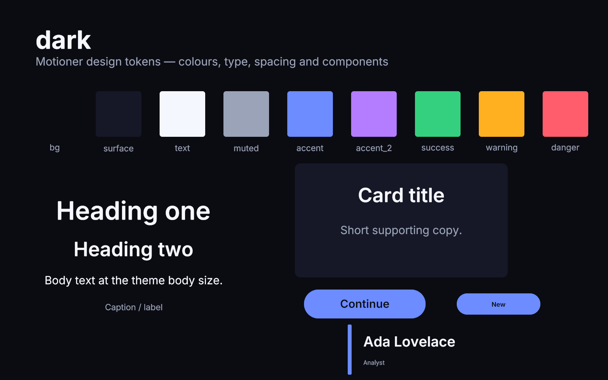 | Near-black, electric blue/violet accent |
| light | 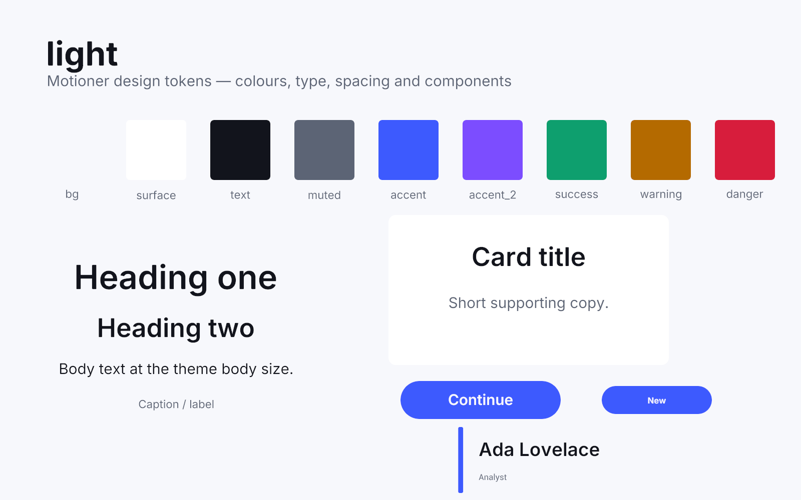 | Cool paper, indigo accent |
| editorial | 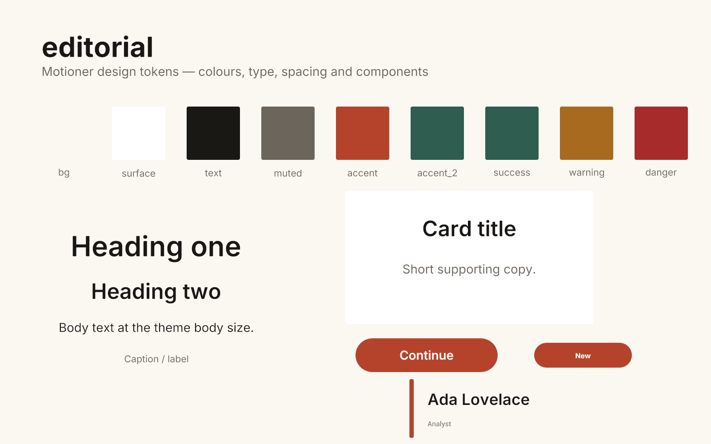 | Warm paper, rust/green, slower tempo |
| playful | 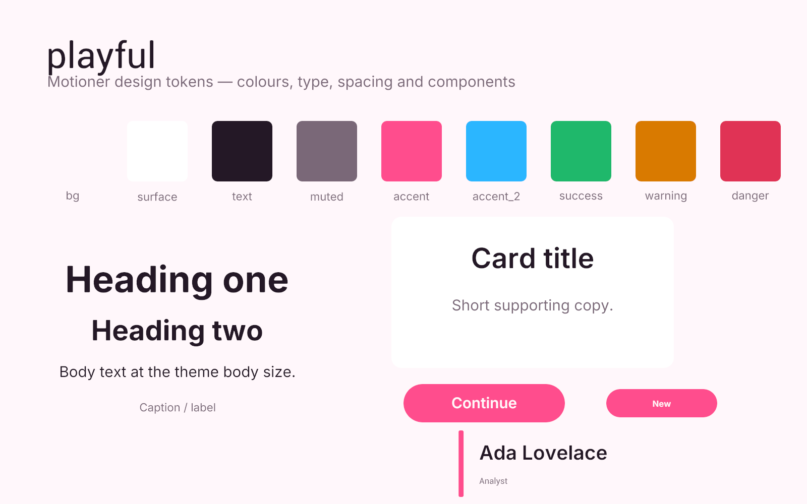 | Blush paper, pink/cyan, bouncy eases |
| corporate | 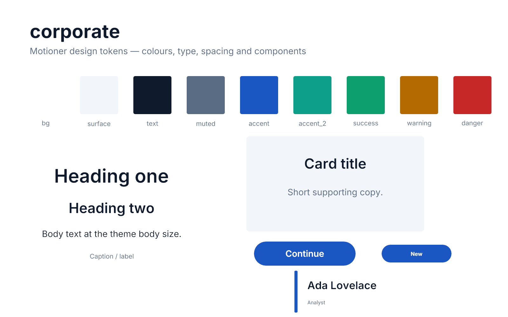 | White, navy/teal, restrained |
| neon | 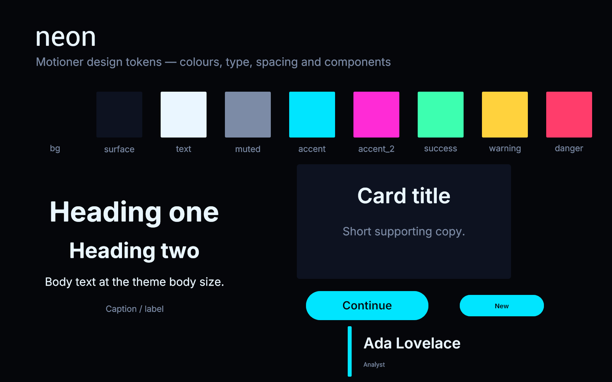 | Black, cyan/magenta, expo eases |
| pastel | 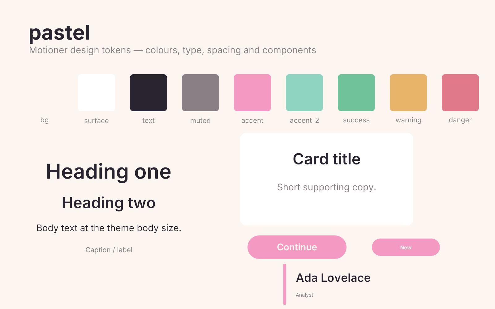 | Cream, rose/mint, sine eases |
| mono | 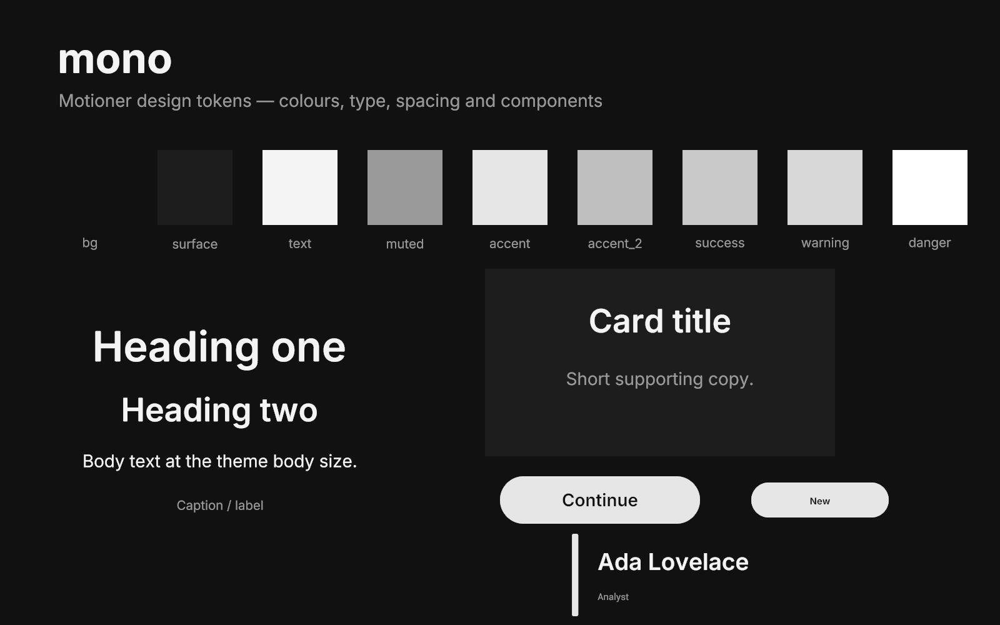 | Graphite, no radius, tracked caps |
| warm | 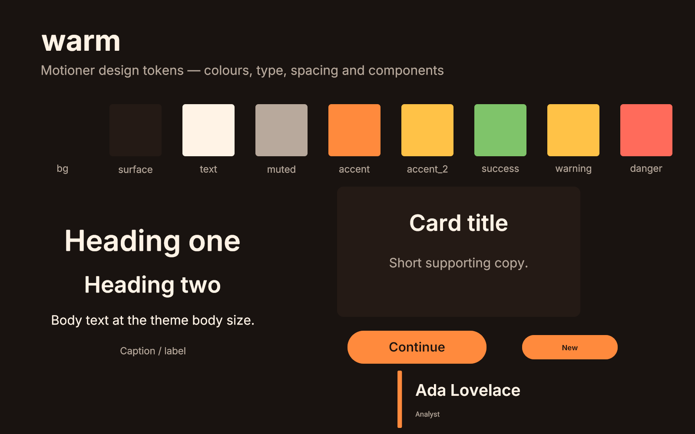 | Espresso, amber, generous spacing |
| tech | 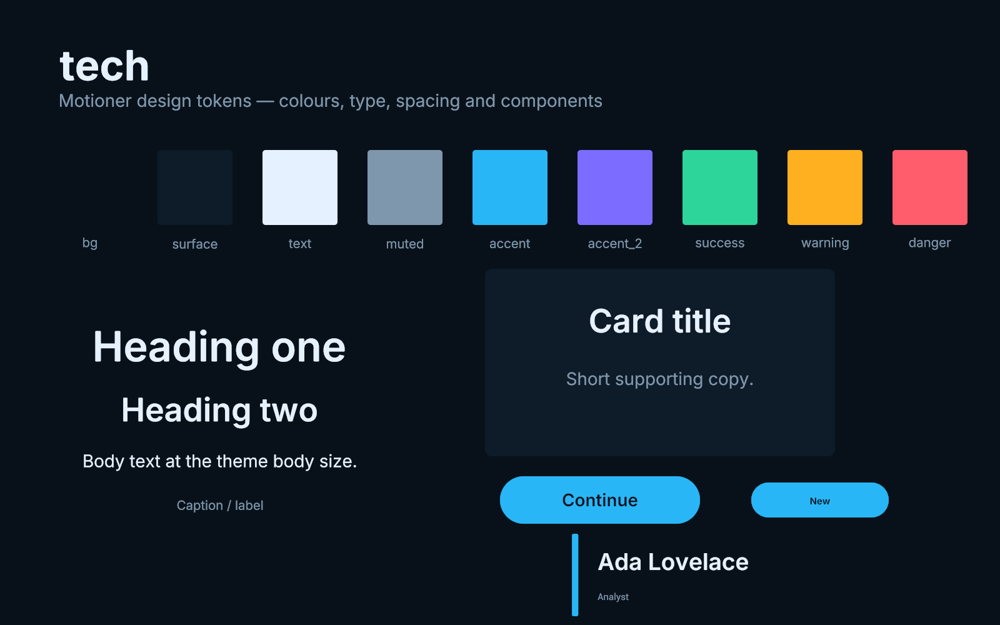 | Deep blue-black, cyan/violet, expo |

## Relative layout

```python
title.place("top", margin="l")
row([a, b, c], gap="m", align="center")
grid(cards, cols=3, gap="l")
stack([background, vignette, title])
box = node.bounds()   # left, top, right, bottom in composition space
```

Anchors: `center`, `top`, `bottom`, `left`, `right` and the four corners
(`top_left`, `top_right`, `bottom_left`, `bottom_right`). `x`/`y` are
fractions of the composition (0–1). Text gets a title-safe 10 % default
margin. `row`/`column`/`grid`/`stack` measure text with the same
`TextMetrics` the renderer draws with (D-0035), so layout and pixels agree.

## Beats and scenes

```python
comp(..., tempo=120)
at = beat(2)          # 1.0 s
scene("intro", 0.0, 4.0)
local = intro.t(0.5)  # absolute seconds
```

Durations in the presets are in beats; `at` is absolute seconds. A scene is a
named group visible only inside its window. The document has no keyed
visibility channel yet, so visibility compiles to opacity hold keys; this
keeps scenes ordinary nodes and the outline shows them.

## Motion presets

`enter` / `exit`: `fade`, `rise`, `drop`, `slide`, `pop`, `zoom`, `blur`,
`wipe`, `draw`, `spin`.
`emphasis`: `pulse`, `shake`, `wiggle`, `glow`, `bounce`.
Also `move_to`, text `reveal` (`fade`, `rise`, `mask_up`; `by=char|word|line`)
and `enter_all` / `exit_all`.

```python
title.enter("rise", at=0.0, duration=2.0)
card.exit("fade", at=beat(12), duration=1.5)
heading.reveal("rise", at=0.5, by="word")
```

Every preset emits ordinary keys, uses theme motion tokens and beats, and is
reviewed as a 15-frame GIF on the dark theme (also in `out/std/presets/`).

| Preset | GIF | Preset | GIF |
|---|---|---|---|
| fade |  | rise | 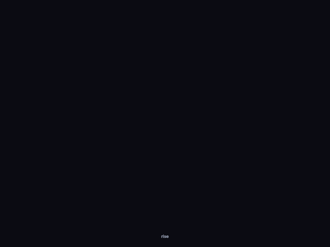 |
| drop |  | slide |  |
| pop | 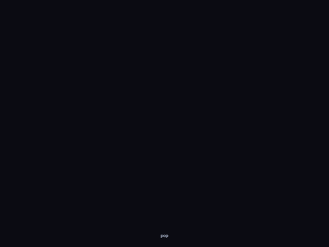 | zoom | 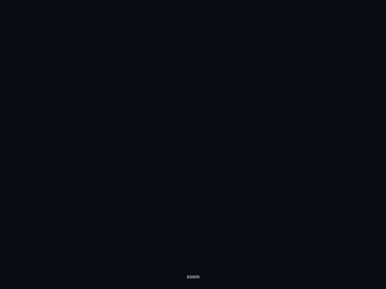 |
| blur |  | wipe | 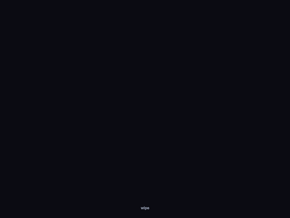 |
| draw |  | spin |  |

`count_up` is not shipped yet because MDF has no animatable text-content
channel (`T-DSL-0024`).

## Components

`card`, `title_card`, `lower_third`, `logo_lockup`, `badge`, `button`,
`bar_chart`, `progress`, `background(kind)`. Each returns a group with named
parts (`card.title`, `lower_third.name`, ...), takes theme tokens and never
hard-codes a palette. `background` supports `gradient_drift`, `grain` and
`glow_orbs`.

```python
c = card("Ship it", "A deterministic pipeline.")
c.place("center", x=0.66, y=0.58)
```

## Limitations and next work

- `bounds()` parity with the rendered alpha box is asserted in the model; the
  renderer comparison test and the full theme × preset matrix are backlog
  (`T-DSL-0024`).
- Scenes are named groups, not yet labelled ranges in the timeline model.
- `reveal(by="word"|"line")` still uses the per-character animator with a
  larger stagger; the renderer has no word grouping yet.
- Design analysis (`check_design`, `motion_report`), render tools, media
  analysis and the `motioner tool` runtime are prompts 13 phases 7–10 and are
  tracked as `T-DSL-0020`, `T-DSL-0021`, `T-DSL-0022` and `T-AI-0003`.
